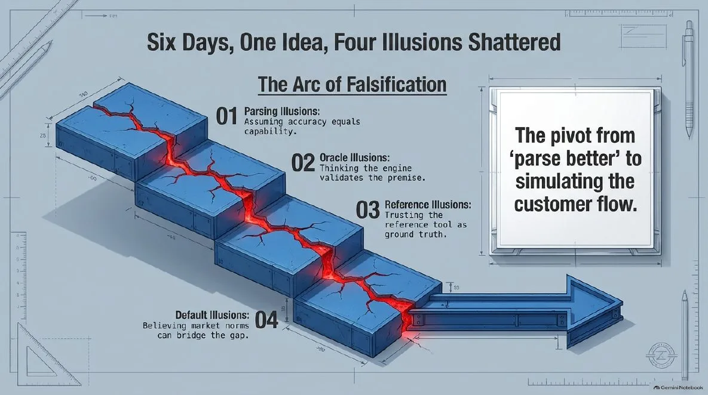
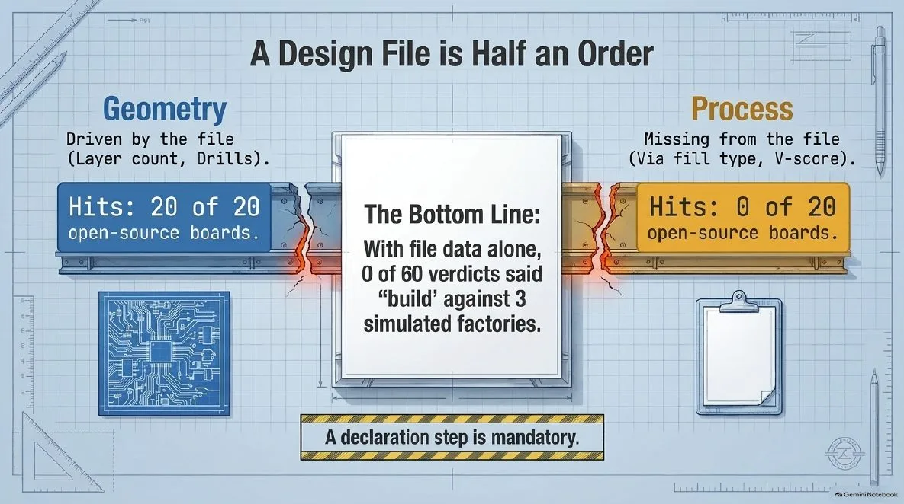
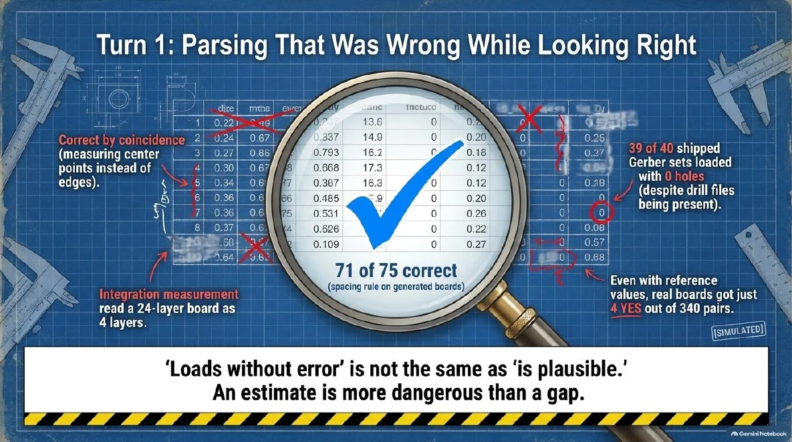
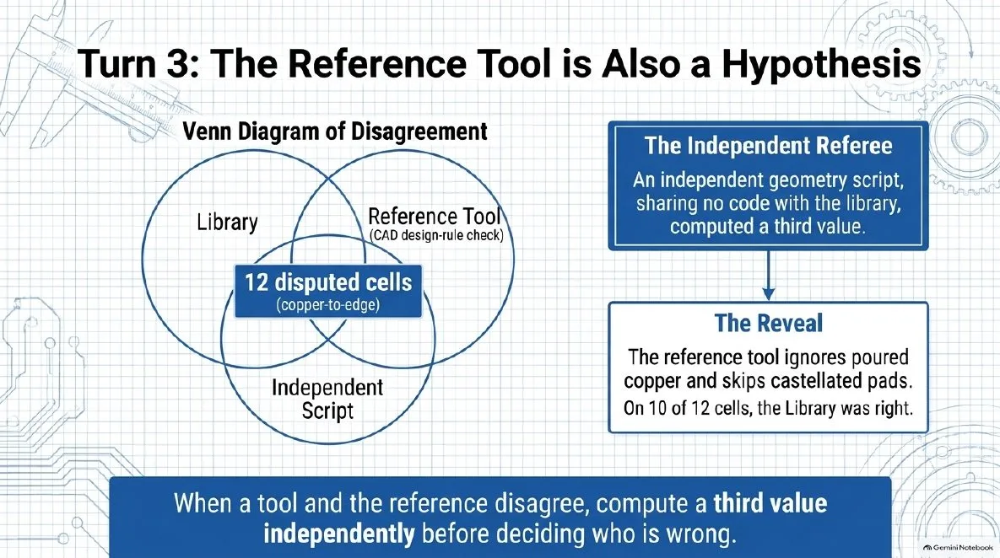
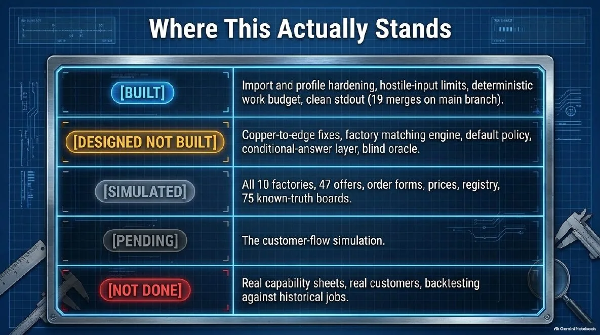

# Measuring the Measuring Stick: Six Days of Explorative Development on a Board-Matching Idea

I set out to teach a library to read circuit boards better. I ended up learning what my own measurements were made of.

The setting: six days in November, one idea. A hardware marketplace takes a customer's circuit-board design file and says which factories can build it. To test that, we taught a design-file library to read a board into a requirements profile, built a factory-matching engine, and wrote a registry of factories to match against. Every factory in this story is one we wrote ourselves. I will say "simulated" next to every number about matching, every time, because that is what they are.

Each time a number looked good, the next round showed it was partly measuring us. That happened four times. The last turn was the useful one: it moved the question from "parse better" to "what does the customer flow look like". That simulation was running when I wrote this. It is a humbling way to spend a week.

<!-- more -->

## Start from what exists, and label the rest

The idea was labelled **Idea** on day one, and the first pass read the existing systems before anyone wrote code. Today's broker flow at a marketplace like this is a person sending a request to several vendors and picking a quote by hand, with no record of *why* a vendor was capable. Nothing resembling a marketplace existed. A skeptic was part of that first run, not an afterthought, and the press text drafted alongside was only allowed to say "planned".

That sounds like bureaucracy. It is what lets the labels in the rest of this post mean something. **Built** is merged on the library's main branch. **Designed not built** is research code. **Simulated** is data we made. Nothing in this post is proven in a pilot: no real factory and no real customer has seen a verdict.

## A design file is half an order

On day two we measured the shape of the problem on 20 real open-source boards, read locally. The design file gives layer count and drill sizes on 20 of 20. It gives surface finish on 2 of 20, via fill on 0 of 20 and V-score on 0 of 20. The geometry half of a requirements profile comes from the file; the process half does not. With file data alone, 0 of 60 simulated verdicts said "build" (20 boards against 3 factories we wrote: two simulated, one a composite of public data). A declaration step is mandatory, and we knew that on day two.

Then we built the bench: an open-source corpus parsed locally and never executed, 75 generated boards with a known truth (simulated), and a registry of 10 simulated factories with 47 simulated offers. "Truth" for the real boards means what the file declares or what an independent reader computes, never what a factory built.

## Turn 1: parsing that was wrong while looking right

The first measuring stick to fail was the library's own reading. Values came back confident and wrong. Minimum copper spacing, measured on the library's imports, was right on 3 of 35 real boards. A spacing rule scored 71 of 75 on the generated boards, which looked excellent until we saw that it measured centre points rather than edges; it was right by coincidence. Copper weight was always 1 oz. Copper-to-edge used a bounding box. An integration measurement against a simulated factory found a false "buildable": a 24-layer board read as 4 layers.

The other formats were worse. 0 of 18 real boards in one proprietary CAD format imported. 0 of 25 jobs in a common CAM exchange format. 0 of 49 shipped Gerber sets were plausible; 39 of 40 loaded with zero holes although the drill files were right there. "Loads without error" and "is plausible" are very different numbers. Even when the engine was handed reference values instead of the library's, the real boards got 4 YES out of 340 pairs against the simulated factories.

A sensitivity run against the simulated factories showed that the 1 oz copper estimate was the only source of false "buildable". An estimate is more dangerous than a gap. The design answer was a source tag on every value, such as MEASURED, DECLARED, ESTIMATED or MISSING, and a rule in the research engine: it refuses to let an estimate decide a verdict where it could flip one.

## Import fixed, matching unmoved

Over the next days a lot of real work landed. Nineteen changes merged on the library's main branch, two of them dependency bumps; all **Built**. Inputs that load went from 62 to 122 of 122. Plausible profiles went from 3 to 78. Holes were found in 48 of 48 Gerber sets that ship drill hits, up from 1.

And the values that decide matching barely moved. Spacing was right on 4 of 35 real boards. Matching with reference values was still 4 YES of 340 pairs, simulated. The 11 YES the profile produced over 1,450 simulated pairs all came from one simulated offer that checks only 3 rules. The status we wrote said it plainly: matching quality is unchanged by this work. Measuring also found a defect the tests had not: the profile depended on machine load, because the geometry budget was a wall clock.

How those nineteen merges happened matters for the rest of the story. The builders were models. So were the reviewers. A human ran every push and every code merge, one script per step; the one merge no person ran was an automatic dependency bump. No CI gates the library, so the suite run before each push is the only gate. A reviewer had to run 12 to 18 mutations (remove the fix, watch the test go red) and feed five hostile inputs; a verdict with 0 mutations run was invalid. Units took 2 to 6 review rounds each. Hostile input found something in every parser. When an agent's report contradicted the logs, the logs won. None of this proves the code correct. A mutation run shows that the tests fail when a fix is removed, nothing more.

One rule came out of those reviews. The slot count on a Gerber package came back wrong four times in a row, each time under a wider file-naming case. The fix that held changed the shape of the rule: on a Gerber package the slot count is never MEASURED. A clean package pays that price too, and we took it on purpose. After two passes at the same defect class, stop patching cases and change the rule.

## Turn 2: measuring our own measuring stick

On day five, a separate model-based analysis was asked where the real loss was. Its answer: no longer inside the parsers. First, order-form facts that are in no design file; second, facts dropped between file and matcher; third, measurement debt, because we did not yet know whether spacing was good.

A measurement pass followed, and this time the bars were written to a file before any experiment ran. The file times prove the order, and the file says the thresholds are not moved after seeing numbers. Spacing on real boards went from 4 to 20 of 35, and in the same change every spacing value was demoted to ESTIMATED. Three falsification runs on the simulated factories did not kill the premise: a matcher using only the order form agrees on 0.615 of decided simulated pairs against a bar of 0.90, and is never wrong, only silent; realistic measurement error flips 1.97 percent of decided simulated verdicts against a bar of 33 percent; noise in the simulated factory limits gives a ratio of 0.90 against a bar of 2, and 2.1 on the cells where the profile is complete, so there factory-data precision matters about twice as much as parse precision.

Then the oracle. The engine had agreed with our first oracle on 0.829 of 750 simulated pairs. That oracle had the same author and the same factory data as the engine, and had been tuned after the first comparison. So a blind oracle was written without reading the engine; its code, its interpretation choices and its first verdicts were hashed and frozen before any comparison. Exact agreement on the simulated pairs: 0.647, or 0.723 once both used the same copper definition. On simulated pairs both decide, they never contradict each other once that definition is shared, 378 of 378. The gap is the YES class: the engine says YES on 140 simulated pairs, the blind oracle on 74.

None of those three numbers is accuracy. The 0.829 was self-consistency, not validation. The blindness is self-attested, and both oracles read the same normalised factory data, so a shared misreading cannot be caught this way. What the blind check did show is that the NO side held, and that the engine's YES side did not.

## Turn 3: the reference is also a hypothesis

The cells on real boards where the library said MEASURED and the reference disagreed went from 36 to 22 after the merges. The largest remaining class was copper-to-edge: 12 cells, judged against a CAD tool's own design-rule check. The plan was to fix the library.

Instead a third value was computed, by an independent geometry script that shares no code with the library. It showed that the reference ignores poured copper, skips edge-connector and castellated pads, and reports the first edge it finds rather than the nearest. On 10 of 12 cells the library was right. At least two were real library defects: a dropped macro pad, wrong by 0.56 mm in the unsafe direction, and old-format zone fills drawn without their pen. Those two fixes sit on local branches under review with mutation runs. Not merged: **Designed not built**.

So "36 to 22" is not a clean headline. The honest count for that field is 2 known defects, not 12, and nobody re-scored the other fields with a better reference, so the true total below 22 is unknown. A design-rule check is a design view, not a factory. When a tool and the reference disagree, compute a third value independently before deciding who is wrong.

## Turn 4: the defaults idea fails, honestly

"Assume the market norm and ask the customer to confirm" sounds like a product. A conditional answer: *YES, if you accept these assumptions.* We prototyped it as research code, **Designed not built**, against the simulated factories.

On today's inputs the default policy turned 0 of 1,179 simulated UNKNOWN pairs into a YES. In a design-only frame, 9 simulated pairs converted. A skeptic pass, re-deriving the numbers from the stored outputs with its own script, found all 9 at one simulated factory, all hinging on one via-fill default that the generated truth does not match. Genuine conversions, simulated: 0. Of the defaults with a simulated known truth, 792 of 4,229 were wrong, 18.7 percent, in a generator mix we chose ourselves; 54 of those wrong defaults produced a simulated false YES. Had a simulated customer accepted every pre-condition, 55 of 196 conditional YES would have been wrong. A YES that rests on a default is a YES on request.

What did work: questions per board fell from a fixed 30 to about 5 to 7 against the simulated registry. The library's own auto-fix could not supply suggestions either: 0 of 75 generated and 0 of 22 small real boards improved, and the trace fixer crashes on round apertures. The recommendation from that pass was: do not build the conditional layer yet. Fewer questions is the one thing worth keeping.

## The order form blocks every undecided real pair

Day six, morning. A ranking experiment asked which extra profile field, if the library could read it, would decide the most pairs against the simulated registry. Every gain was UNKNOWN to NO. Every simulated UNKNOWN pair is blocked by many fields at once, a median of 11 to 25 depending on the board set. On the real boards, every simulated UNKNOWN pair, 112 of 112 on one path and 87 of 87 on the other, names the via-fill type, an order-form field no importer measures. It is not the only blocker: each of those pairs also waits on geometry fields the registry never assumes, and on feature classes whose absence the library cannot prove. The best single real field decides 15 of 480 simulated pairs, all as NO.

A stop rule was written before the next build round: the baseline decided share on the pooled real boards against the simulated registry is 58.5 percent, 281 of 480, and if the three best missing fields raise it by less than 5 points, do not build. It has not been evaluated, so I will not say it passed or failed. What the data so far says is that coverage buys UNKNOWN-to-NO, which is correct pruning. It does not buy YES. So the question moved from the parser to the conversation, and to rules the registry has not written yet.

!!! note "A design file is untrusted input"

    Anyone can upload a file to a matching service. Code reading plus generated hostile files found something in every parser: XML external entities and entity bombs, archive bombs, deep nesting, huge files, counts read from a file and trusted, a file over one parser's cap that a later step read whole. Path traversal in archive names was checked and refuted; the runtime already refuses it. **Built.**

    Geometry work is bounded by a budget counted in units, not wall-clock seconds, so the same file gives the same profile on a loaded and an idle machine. When the budget runs out, the field becomes MISSING or ESTIMATED with a reason, never a wrong MEASURED value. 260 runs, no budget hit; two passes identical on 259 of 259. **Built.**

    The profile carries no text from the design. File names, layer names, net names, archive entry names and notes are designer text and can be confidential; the profile holds numbers, counts, a closed vocabulary and the library's own words.

    The leak the reviews missed: the command printed designer file names to the console through a converter's chatter. Reviewers are models too, and they check what you tell them to check; the earlier briefs asked about wrong values, not output channels. The fix is a canary token in every designer-typed name and a grep of stdout, stderr, JSON and text output. **Built.** Privacy has to be a first-class check in every review brief, or a model reviewer will not look for it.

## What stays open, and the turn to the customer flow

There is no backtest. Thirty to a hundred historical jobs under NDA would be the only way to measure agreement with real CAM judgement, and it has not been requested. The confirm-or-correct note to the operator's CAM engineers was written and not sent. There is no real factory data; every factory is simulated. No real customer has seen a verdict, and nothing is proven in a pilot. Until real capability sheets and a backtest exist, a high agreement number would only show that the engine agrees with itself.

Having learned that parsing alone cannot unblock a single undecided real pair, the next step became simulating the customer flow itself: what a customer uploads, what is asked, in what order, and what the marketplace can honestly say at each step. That flow was designed and a first run was in progress when this was written. I would rather publish the week without its last number than invent it. The design itself predicts that no sequence of answers turns an UNKNOWN pair into a YES on today's profiles; that is a prediction, not a result. Whatever comes back, the irreplaceable signal stays the same: a backtest.

Six days, four turns, and the honest summary is that the idea does not yet pay in numbers. The file cannot decide a real pair on its own: every undecided one also waits on an order-form field, and on rules the registry has not written yet.

## Where this actually stands

| Thing | Label |
|---|---|
| Import and profile hardening in the design-file library: hostile-input limits, no designer text in the profile, deterministic work budget, DEFAULT layer, net-aware spacing, slot and drill rules, clean stdout. 19 changes merged on its main branch, 7 to 9 November. | **Built** |
| The two copper-to-edge fixes (dropped macro pad, old-format fill pen) | **Designed not built** (local branches, under review, not merged) |
| The factory-matching engine, the default policy, the conditional-answer layer, both oracles, the harness | **Designed not built** (research code) |
| The coverage round, and its stop rule | **Designed not built**; stop rule written, not evaluated |
| The customer-flow simulation | **Pending** (designed; first run in progress when this was written) |
| All 10 factories, 47 offers, order forms, prices, the registry, the 75 known-truth boards | **Simulated** |
| Anything with a real factory, a real customer or a real fabrication outcome | **Not done. Nothing is proven in a pilot.** |

*Real boards in this story are open-source designs read locally. Their "truth" is what the file declares or what an independent reader computes, never what a factory built.*

*Built with agents under human review; every push and every code merge was run by a person, and the one other merge was an automatic dependency bump. Every factory, offer and customer in this post is simulated. Nothing here has been tried on a real order. The slides were generated from this material and checked against the text; the ones that did not match were left out.*
