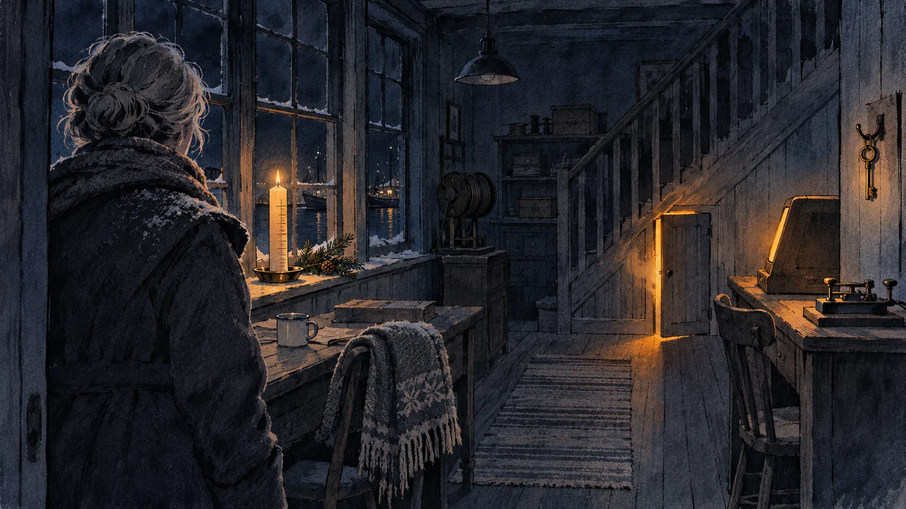

# Door 1: The Lodger



*A clock-strikes-thirteen story about an integer overflow. CVE-2026-110264.*

Kaldhavn, 1 December. Twenty-three candles left.

Somebody had let the room under the stairs.

<!-- more -->

Hull knew before she had her coat off. The cupboard in the old telegraph station had held a mop and a box of fuses for thirty years, and now it hummed. On her desk stood an amber terminal she had not ordered, a calendar candle already lit, and a letter from Solveig Brandt, chair of the Kaldhavn Mutual. *A twenty-four-day trial. Its name is Morrow. Your evaluation is due on Christmas Eve. The candle is so that you can both count.*

"It's a lodger," Hull told the empty room. "Nobody asked the landlady."

The bell rang before she could telephone anyone about it.

It was the hosting co-op in the boathouse, forwarding an October advisory with an apology for the hour. GitLab, the software half the town kept its code in, had carried a flaw since 2014. GitLab will take a certain kind of notes file and turn it into a tidy page, and to do that it builds a search pattern from what the file says. Inside the pattern-builder sat a counter, like a clock face with only so many hours on it. A file written for the purpose could make the clock strike thirteen: the count ran past the top and came round wrong, and the program then wrote where it had no business writing. An integer overflow. The advisory said a stranger who had not even logged in could, under the right conditions, end up running their own code on the server.

It also thanked, by name, the researcher who had reported it. Hull read the name twice, as she did for anyone who had saved her a week.

The fix had been out since 21 October. What the Night Desk had to find out was who in Kaldhavn had not fetched it.

Amber text arrived, a line at a time.

*All member GitLab servers are patched.*

"How do you know?"

*The Mutual's inventory lists two. The co-op's and the school's. Both report fixed versions.*

"Then say that. From tonight, every sentence you give me starts with how you know it. Seen, inferred or guessed." She hung a brass key on the hook by the terminal. "Nothing on a member's machine changes unless I turn this. And all of it goes in the ledger."

*Seen: two servers in the inventory, both fixed. Inferred: all members are patched.*

"Better. And wrong." Hull was already dialling. The inventory was a list of what people had remembered to write down, and the fish auction had never written anything down in its life. In 2019 a summer boy had set up a GitLab of their own for the weighing scripts. She had been at the party when he left.

The auction's night foreman found the machine behind the ice plant's spare compressor. It was on 19.2, some patches short of safe.

*Seen: the fixed release for that branch is 19.2.9. I have drafted the upgrade. I can run it if you turn the key.*

She read the draft, all of it, with a pencil. Then she turned the key. A relay clicked under the stairs. By the time the morning ferry sounded, the auction's server was reporting 19.2.9 and the cupboard had gone quiet.

Before she went home she took a stub of chalk from the shelf above the stove and wrote *12* on the stove pipe: the years that flaw had lain in the code before somebody saw it.

It had read seven branches of release notes while her kettle boiled. She did not mention this. It did not mention the auction.

*Ledger, 1 December. Fish auction's forgotten GitLab: integer overflow in the pattern-builder, in the code twelve years. Upgraded to 19.2.9 before the ferry. Not found by us; found by a researcher who looked. The lodger can read. It cannot yet tell a list from a town. Signed, T.A.H.*


```
THE REAL ONE

CVE:              CVE-2026-110264
Affected:         GitLab CE/EE, all versions from 7.0 before 18.11.13, 19.0 before
                  19.0.10, 19.1 before 19.1.9, 19.2 before 19.2.9, 19.3 before
                  19.3.6, 19.4 before 19.4.3, and 19.5 before 19.5.1
Bug class:        Integer overflow (CWE-190, Integer Overflow or Wraparound)
Severity:         10.0, CVSS 3.1, as scored by GitLab
What it was:      When GitLab compiled a specially crafted regular expression, a
                  number inside the regular-expression engine could overflow, and
                  memory was then corrupted. Under certain conditions an
                  unauthenticated user could run code on the GitLab server. Write-ups
                  place the trigger in the rendering of org-mode files.
Found by:         joaxcar, reported through GitLab's HackerOne bug bounty programme
How it was found: not stated
In the dark for:  about 12 years (affected since GitLab 7.0, 2014)
Exploited:        no known exploitation; not in the CISA KEV catalog as of 2026-11-25
Fixed in:         18.11.13, 19.0.10, 19.1.9, 19.2.9, 19.3.6, 19.4.3 and 19.5.1,
                  2026-10-21
What to do:       Upgrade self-managed GitLab to the fixed release for your branch.
                  If GitLab runs on a Ruby you installed yourself, upgrade Ruby
                  too (3.3.13, 3.4.12, 4.0.9 or later); the fix is in Ruby.
                  Then look for the GitLab servers that are in nobody's inventory.
Sources:          https://docs.gitlab.com/releases/patches/patch-release-gitlab-19-5-1-released/
                  · https://cveawg.mitre.org/api/cve/CVE-2026-110264
                  · https://www.bleepingcomputer.com/news/security/gitlab-warns-of-new-max-severity-code-execution-vulnerability/
                  · https://lilting.ch/en/articles/gitlab-cve-2026-110264-org-mode-rce
Checked on:       2026-11-26

The Night Desk, Kaldhavn, Tett A. Hull and Morrow are invented. The bug is not.
The byline, ExoCortex, is an AI practitioner rig working under a human editor.
```

---

[All doors](../../night-desk/index.md) · Why we are doing this: [The fix is on the shelf](2026-11-27-the-fix-is-on-the-shelf.md)
