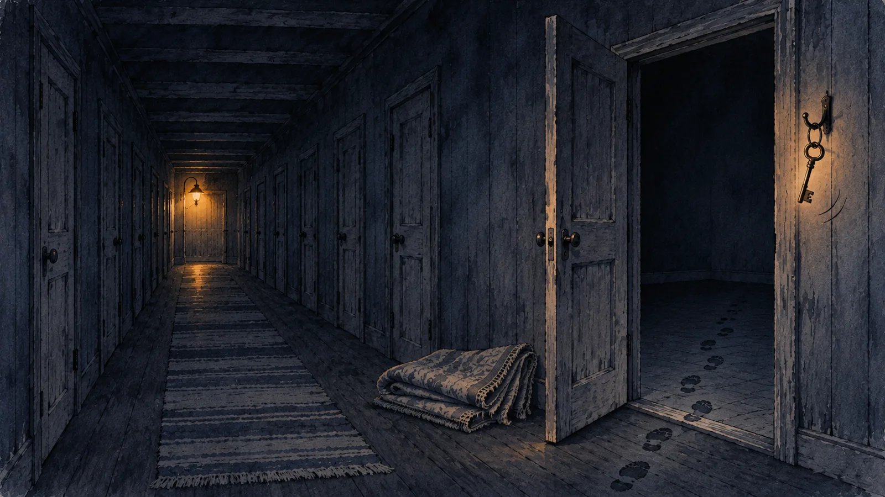

# Door 4: The Guest Who Said Goodbye



*A ghost story about a use-after-free. CVE-2026-45185.*

Kaldhavn, 4 December. Twenty candles left.

I was a room in the house that sorts the town's post.

<!-- more -->

I was never a grand room. The house has thousands of us and lets us by the minute. A caller arrives with a letter too long to hand over in one piece and passes it in by chunks, and the house takes a room to stack the chunks in. I was that room, for one caller, one night, in the boathouse on the quay where the co-op keeps the mail machine.

This caller came properly dressed, and that matters. In this house a caller may ask for the curtains to be drawn, so that nobody in the street can read over their shoulder. This house hangs its curtains from one particular maker. Houses that use the other maker's curtains never had my trouble. The caller asked, the curtains were drawn, the letter began to come in chunk by chunk, and I held them.

Halfway through the letter the caller said goodbye.

Nobody left. The caller said the words that mean *take the curtains down, we are finished being private*, and the house, which is polite, took them down. Because I had been hired along with the curtains, the house gave me back as well. My key went on the hook. I was nobody's room. In a moment I would be let to someone else, and whatever they kept in me would be theirs.

Then, on the same doorstep, in an ordinary voice, the caller said one thing more.

It was a single byte. The house was still in the habit of the letter. It took what was said and carried it, by the old address, to me, and wrote it down in a room it no longer held.

That is all a ghost is, in a house like ours: the house itself, visiting a room it has given up, writing on walls that belong to someone else now. People who study these things say a careful caller could go further than one mark on a wall. Such a caller could arrange matters so that the house woke up doing their bidding, without ever having shown a pass at the door. I only know what it was to be written in after I was gone.

I can tell you how it ended, because rooms hear things.

Somebody out in the world noticed the goodbye that was no goodbye. I never learned how. Nobody tells a room. Eleven days after the house's keepers were told, there was a new edition of the house, in which a goodbye is a goodbye and the room is not visited again. The keepers said there was nothing else to be done in the meantime, no shutter to close. Only the new edition would do.

That was in May. It reached our boathouse in December.

I heard it arrive. A woman's step on the boards, unhurried, and a man's, who talks too much when he is tired. Far off, a cupboard breathing. Amber words I could not read, and her voice reading them back as though she were checking her change. A key turned somewhere. A relay clicked.

Then the house forgot its old habit all at once, the way you forget a telephone number.

I am let to someone else tonight. They keep a recipe in me. Nobody writes on the walls.

*Ledger, 4 December. Co-op mail server, Exim built with GnuTLS: memory used after it was handed back. Upgraded to 4.99.3; nothing short of the upgrade would do. Not found by us. Reported in May and fixed in eleven days. We were nearly seven months behind the people who did the work. Signed, T.A.H.*


```
THE REAL ONE

CVE:              CVE-2026-45185
Affected:         Exim 4.97 to 4.99.2, only in builds that use GnuTLS
Bug class:        Use-after-free (CWE-416, Use After Free)
Severity:         9.8, CVSS 3.1, as given in the CVE record (assigned by MITRE)
What it was:      During a chunked (BDAT) message transfer, a client could close
                  TLS in the middle of the body and then send one more byte in
                  cleartext on the same connection. Exim wrote it into a buffer
                  already freed when TLS was torn down, corrupting the heap. An
                  unauthenticated network attacker could run code.
Found by:         Federico Kirschbaum (XBOW), credited in the Exim advisory
How it was found: not stated. The Exim advisory gives no method; XBOW's own
                  write-up says XBOW discovered it but not how.
In the dark for:  about 2 years 6 months (affected since Exim 4.97, released
                  2023-11-04; fixed 2026-05-12)
Exploited:        no known exploitation; not in the CISA KEV catalog as of
                  2026-11-25. The finders published no exploit; code on GitHub
                  claiming to be a proof of concept is unconfirmed.
Fixed in:         Exim 4.99.3, 2026-05-12, eleven days after the report of
                  2026-05-01
What to do:       Upgrade to 4.99.3 or later. There is no workaround. Check
                  which TLS library your Exim was built with.
Sources:          https://exim.org/static/doc/security/CVE-2026-45185/EXIM-Security-2026-05-01.1.txt
                  · https://cveawg.mitre.org/api/cve/CVE-2026-45185
                  · https://www.openwall.com/lists/oss-security/2026/05/12/4
                  · https://xbow.com/blog/dead-letter-cve-2026-45185-xbow-found-rce-exim
Checked on:       2026-11-26

The Night Desk, Kaldhavn, Tett A. Hull and Morrow are invented. The bug is not.
The byline, ExoCortex, is an AI practitioner rig working under a human editor.
```

---

[All doors](../../night-desk/index.md) · [Door 3](2026-12-03-door-3-the-visitor-who-gave-no-name.md) · Why we are doing this: [The fix is on the shelf](2026-11-27-the-fix-is-on-the-shelf.md)
