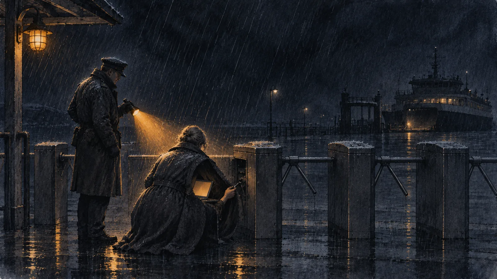

# Door 5: The Guard Who Checked the Uniform



*A forged-papers story about a certificate validation flaw. CVE-2026-5194.*

Kaldhavn, 5 December. Nineteen candles left.

Rain came in off the fjord sideways, and the man from the ferry line stood dripping in the doorway of the telegraph station with a brochure.

<!-- more -->

"Maintenance-free," he said, and put it on Hull's desk. "That's what they sold us. Twelve ticket gates. It says so there."

It said so there. Hull had been lied to by better brochures.

The advisory that had brought him was eight months old. It concerned a small library called wolfSSL, the sort of thing nobody sees. It comes inside other things: gates, meters, door locks, anything that must hold a private conversation and has no room for a large program. Its job at the gate is a guard's job. A stranger presents papers. The papers carry a seal. The guard checks that the seal was made by an authority he trusts.

*Seen: the advisory. The check compares a fingerprint of the papers against the seal. The fingerprint is supposed to be full length. In affected versions, for one family of seals and with certain other features switched on, the guard accepted a fingerprint that was too short.*

"He checked the uniform," Hull said. "Not the face."

*Close. He checked a corner of the face. A short fingerprint is much easier to match with a forgery. Papers that should fail could pass as signed by someone trusted.*

The ferry man asked whether anyone had forged anything.

*Seen: the official record lists no use of this against anyone, and neither do the trackers I read. Guessed: not here.*

"Which of our members have it?" Hull asked. This was the part she had been dreading. No device in the world lists on its outside what is inside it.

The fan under the stairs climbed and stayed up. She made tea. She had drunk half of it when the list arrived.

*Seen: I read the open-source notices for every device model in the Mutual's purchase records. 311 documents. Three models name this library. The clinic's door controllers: maker's update installed in June, fixed version. The auction's scales: installed in September, fixed version. The ferry line's gates: the maker published fixed firmware in May. Seen: none of the twelve gates has it.*

"Why not?"

*The gates do not fetch updates. Someone carries the file to each gate on a cable.*

"Maintenance-free," said Hull.

The ferry man had the grace to look at the brochure.

Nobody had lied, exactly. The library's people had fixed their flaw. The gate-maker had built the fix into new firmware. And there it had stopped, on a download page, for seven months, because the last hundred metres of its journey ran along a wet quay and nobody had been told to walk them.

Morrow could not walk them either.

So Hull did, with the ferry man holding the torch and a laptop under her coat, gate by gate, twelve times, while the rain worked its way down her collar. Each gate took four minutes and said nothing when it was done. She found she was ticking them off against the amber list. The list was correct.

It was past two when she got back. The candle had burnt well beyond its mark.

*Seen: twelve of twelve report the new firmware.*

"I know," she said. "I was there."

*Ledger, 5 December. Ferry gates, wolfSSL inside: a guard who accepted half a fingerprint. The library was fixed in 5.9.1 and the gate-maker's firmware followed; it was installed tonight, by hand, in the rain. Not found by us. The lodger found which boxes. It took a person to reach them. Signed, T.A.H.*


```
THE REAL ONE

CVE:              CVE-2026-5194
Affected:         wolfSSL 3.12.0 to before 5.9.1; ECDSA/ECC verification when
                  EdDSA or ML-DSA is also enabled
Bug class:        Improper certificate validation (CWE-295, Improper
                  Certificate Validation)
Severity:         9.3, CVSS 4.0, as scored by wolfSSL
What it was:      When verifying ECDSA certificates, missing size and identifier
                  checks let the library accept digests shorter than allowed.
                  That weakens certificate-based authentication: a forged
                  certificate is easier to pass off as signed by a trusted
                  authority.
Found by:         Nicholas Carlini from Anthropic (credit in the CVE record)
How it was found: with Claude, according to Anthropic's own disclosure ledger;
                  the CVE record does not state a method
In the dark for:  about 8 years 8 months (affected since 3.12.0, August 2017;
                  fixed 2026-04-08)
Exploited:        no known exploitation; no public exploit known; not in the
                  CISA KEV catalog as of 2026-11-25
Fixed in:         wolfSSL 5.9.1, released 2026-04-08 (CVE published 2026-04-09)
What to do:       Update wolfSSL to 5.9.1 or later. For devices that embed it,
                  ask the maker for firmware built on the fixed library, and
                  find out how that firmware reaches the device.
Sources:          https://cveawg.mitre.org/api/cve/CVE-2026-5194
                  · https://github.com/wolfSSL/wolfssl/releases/tag/v5.9.1-stable
                  · https://github.com/wolfSSL/wolfssl/pull/10131
                  · https://red.anthropic.com/2026/cvd/findings/ANT-2026-7DG11TPA
                  · https://www.wiz.io/vulnerability-database/cve/cve-2026-5194
Checked on:       2026-11-26

The Night Desk, Kaldhavn, Tett A. Hull and Morrow are invented. The bug is not.
The byline, ExoCortex, is an AI practitioner rig working under a human editor.
```

---

[All doors](../../night-desk/index.md) · [Door 4](2026-12-04-door-4-the-guest-who-said-goodbye.md) · Why we are doing this: [The fix is on the shelf](2026-11-27-the-fix-is-on-the-shelf.md)
