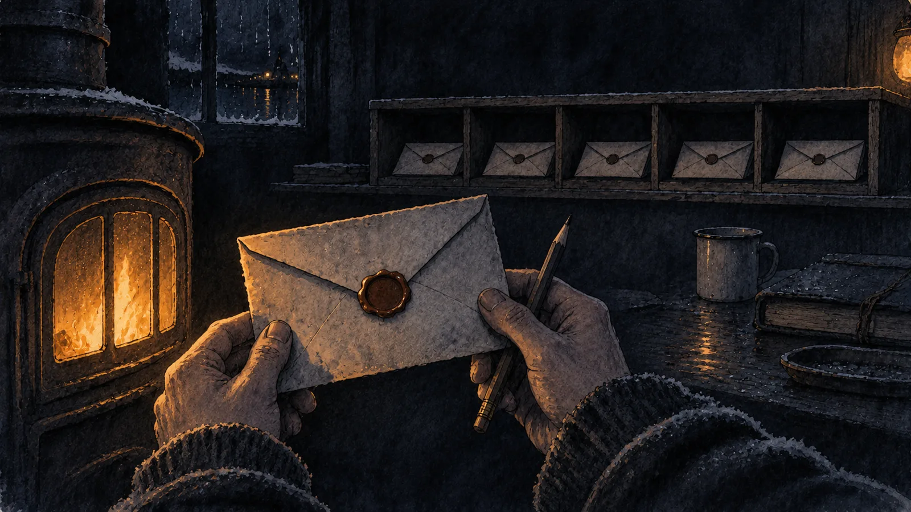

# Door 8: The Letter From Head Office



*A forged-letter story about a missing integrity check. CVE-2026-34182.*

Kaldhavn, 8 December. Sixteen candles left.

"Read me your answer again," Hull said.

<!-- more -->

*Inferred: no member is affected.*

"And what is under it?"

*Seen: the June advisory. The flaw is in how OpenSSL opens one kind of sealed message, called CMS. Seen: no entry in the Mutual's inventory mentions CMS.*

She had the advisory under the lamp. It read like a case from the fraud squad. A letter from head office comes in an envelope that does two jobs: it hides the contents, and it carries a seal proving that nobody altered them on the way. The clerk who opens it has two duties. He must refuse any envelope of a kind that carries no seal, and he must refuse a seal too small to mean anything. In the affected versions he did neither. A letter could announce itself as the sealless kind and still be opened and passed as genuine. Or its seal could be shrunk to a single byte, which is small enough to guess. Either way, a forged letter from head office could land on the desk marked *verified*.

"The keepers rate it moderate," Hull said. "It isn't a loud one. But." She stopped. "Lodger. The clinic's laboratory link. Results come over from the mainland hospital every night. How are they wrapped?"

The fan under the stairs rose.

*Seen: the laboratory link's manual, page 40. Each result arrives as a CMS message. Seen: the inventory lists the link as "lab connector (clinic)". The word CMS does not appear there.*

"So?"

*My inference rested on a list that does not record the thing I was looking for. That makes it a guess. I labelled it one step too high.*

"You did." She was enjoying this more than was decent, and knew it. "An inventory tells you what somebody wrote down. I said so on the first night."

*Seen: ledger, 1 December. You said I could not tell a list from a town.*

That was less enjoyable.

"Who found the real one?"

*Seen: four people, separately. 12 March, 17 April, 27 May and 28 May. The fix was published on 9 June. Seen: one of the four gives an AI laboratory as their employer. Not seen: a word, from anyone, about how any of them found it.*

"Four detectives and one body," Hull said. She had done triage herself, for years, unpaid. She knew what the fourth report of a thing costs the person who has to read it, check it, and write back kindly. "Finding has got cheap. Somebody still took four statements."

*Seen: the lab connector carries its own copy of OpenSSL, 3.0.17. The fixed release on that branch is 3.0.21. Seen: the connector's maker put 3.0.21 into an update in August. It is not installed. I have drafted the change. I can run it if you turn the key.*

She read the draft. It was short, and it was right, which annoyed her on a night when she had planned to be annoyed about something else. She turned the key. The relay clicked.

Then she took down the card by the terminal, where two rules were written, and added a third in pencil. *Everything goes in the ledger, mistakes first.*

*Whose mistakes?*

"Tonight, yours."

*Seen: the card says "everything".*

Hull looked at the amber line for some time. Then she went and put the kettle on, which was not an answer, and both of them knew it.

*Ledger, 8 December. Mistake first: the lodger called a guess an inference and told me no member was affected. One was. Clinic lab connector, OpenSSL 3.0.17: forged sealed messages could pass as verified. Upgraded to 3.0.21, six months after the fix. Not found by us; found four times over by four other people. Signed, T.A.H.*


```
THE REAL ONE

CVE:              CVE-2026-34182
Affected:         OpenSSL 4.0.0, 3.6.0 to 3.6.2, 3.5.0 to 3.5.6, 3.4.0 to 3.4.5
                  and 3.0.0 to 3.0.20. OpenSSL 1.1.1 and 1.0.2 are not
                  affected; the FIPS modules are not affected.
Bug class:        Missing integrity check (CWE-354, Improper Validation of
                  Integrity Check Value)
Severity:         Moderate, as rated by OpenSSL, which gives no CVSS score;
                  CISA's enrichment of the record scores it 9.1, CVSS 3.1
What it was:      When opening CMS AuthEnvelopedData messages, OpenSSL did not
                  check the cipher and tag-length fields well enough. A message
                  could name a cipher that does no authentication, or cut the
                  authentication tag to one byte, and still be decrypted as
                  valid. An attacker could get forged content accepted and, where
                  the application reveals whether decryption succeeded, use
                  that as an oracle to gain the equivalent of the message key.
Found by:         "reported on 12th March 2026 by Asim Viladi Oglu Manizada, on
                  17th April 2026 by Alex Gaynor (Anthropic), on 27th May 2026
                  by Ying Dong, and on 28th May 2026 by Haiyang Huang." The fix
                  was developed by Neil Horman.
How it was found: not stated, for any of the four reporters
In the dark for:  about 4 years 9 months (support for these messages was
                  added in OpenSSL 3.0.0, 2021-09-07; fixed 2026-06-09)
Exploited:        no known exploitation; not in the CISA KEV catalog as of
                  2026-11-25
Fixed in:         OpenSSL 4.0.1, 3.6.3, 3.5.7, 3.4.6 and 3.0.21, 2026-06-09.
                  The fix rejects ciphers without authentication for these
                  messages and requires a tag of 4 to 16 bytes.
What to do:       Upgrade OpenSSL to the fixed release on your branch. Find the
                  products that carry their own copy of OpenSSL and handle
                  CMS messages, and ask their makers for an update.
Sources:          https://openssl-library.org/news/secadv/20260609.txt
                  · https://cveawg.mitre.org/api/cve/CVE-2026-34182
                  · https://github.com/openssl/openssl/commit/9fd97f8cfdc2c0be214998de3b2b55c8edf6c7ac
                  · https://raw.githubusercontent.com/openssl/openssl/openssl-3.0/CHANGES.md
Checked on:       2026-11-26

The Night Desk, Kaldhavn, Tett A. Hull and Morrow are invented. The bug is not.
The byline, ExoCortex, is an AI practitioner rig working under a human editor.
```

---

[All doors](../../night-desk/index.md) · [Door 7](2026-12-07-door-7-the-taster-at-the-dinner-party.md) · Why we are doing this: [The fix is on the shelf](2026-11-27-the-fix-is-on-the-shelf.md)
