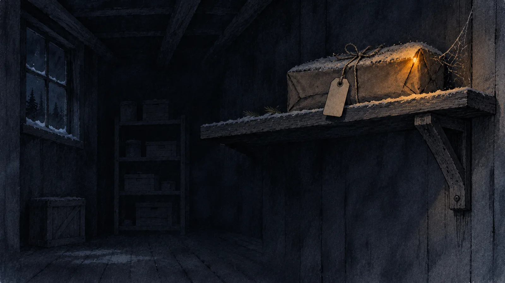

# Door 11: Do Not Open Before Christmas



*A parcel story about a deserialisation flaw. CVE-2026-20963.*

Kaldhavn, 11 December. Thirteen candles left.

I am the remedy, and I have been in a folder since January.

<!-- more -->

I was finished on the second Tuesday of the year. I am not large. I am a set of corrections for a document server called SharePoint, the kind an office keeps in its own back room, and what I correct is its manners with parcels.

The server takes in parcels all day. That is its work. Some of them arrive flat-packed: a description of a thing, which the server puts together into the thing itself, the way a toy is built on Christmas morning from the sheet in the box. The rule ought to be that it builds only what it was expecting. Without me it would build what a stranger sent. And a parcel can be packed, by someone who knows how, so that what stands up out of the wrapping has purposes of its own. The stranger needs no pass at the door.

That is all I know about my illness. It is enough to know what a wrong parcel would look like. I am the only thing in the harbour office that does know, and I was in a folder called *Pending*.

When I was made, my makers judged that the illness was less likely to be used. Sixty-four days later, the people who keep the list of illnesses that are being used added mine to it. They gave their own offices three days. Nobody told the folder.

I was approved in February and scheduled for March. I was moved for the quota deadline, because the document server must not be down that week. I was moved for Easter, and then for the auditor. In July somebody renamed the folder *Pending (old)*.

The parcels kept arriving. I counted them through the wall, having nothing else to do. Each one unwrapped itself in a room I could not see. Most were what they said they were. I expect all of them were. I cannot tell you so. I was not installed, and telling is what being installed is for.

A remedy on a shelf is a kind of ghost. It knows exactly what is wrong in the house, and it cannot lift a hand.

By autumn I had stopped expecting anything. It was eleven months. Offices are busy. Nobody decided against me. I want that understood. Nobody ever decided against me. I was simply never the most urgent thing on any one day, three hundred days running.

Then tonight something across the harbour, in a cupboard, read every folder in the building while looking for something else, and stopped at mine.

After that there was a woman's voice on the office manager's telephone. She was not angry. I had expected anger and was almost disappointed. She said, "It has been approved since February. I'm not asking you to decide anything. I'm asking you for forty minutes." There was a pause, and a sigh, and a yes.

A key turned somewhere. Something clicked.

I was installed at 23:40. The first parcel came at 23:52, and for the first time I looked at one properly. It was a spreadsheet of herring landings. I have never been so glad of anything.

*Do not open before Christmas*, people write on parcels.

I would have settled for January.

*Ledger, 11 December. Harbour office document server, SharePoint: built whatever a stranger's parcel described. The January update, approved here in February, installed tonight. No sign of a wrong parcel; no way now to be sure. Not found by us; its finders are not named. The lodger found the folder. The forty minutes took a telephone call. Signed, T.A.H.*


```
THE REAL ONE

CVE:              CVE-2026-20963
Affected:         Microsoft SharePoint Enterprise Server 2016 before
                  16.0.5535.1001; SharePoint Server 2019 before
                  16.0.10417.20083; SharePoint Server Subscription Edition
                  before 16.0.19127.20442
Bug class:        Deserialisation of untrusted data (CWE-502, Deserialization
                  of Untrusted Data)
Severity:         9.8, CVSS 3.1, as scored by Microsoft (Microsoft's own
                  severity rating is "Important"; it revised the score on
                  2026-03-17)
What it was:      SharePoint rebuilt objects from data supplied by a caller
                  without sufficient checks. In Microsoft's words:
                  "Deserialization of untrusted data in Microsoft Office
                  SharePoint allows an unauthorized attacker to execute code
                  over a network."
Found by:         not credited by name. Microsoft acknowledges two finders,
                  one "Anonymous" and one listed only by an identifier.
How it was found: not stated
In the dark for:  not stated
Exploited:        yes, according to CISA, which added it to the KEV catalog on
                  2026-03-18, 64 days after the update, with a due date of
                  2026-03-21. Microsoft's own advisory, as read on 2026-11-26,
                  still shows "Exploited: No" and "Exploitation Less Likely".
Fixed in:         the security updates of 2026-01-13: KB5002828 (2016),
                  KB5002825 (2019) and KB5002822 (Subscription Edition)
What to do:       Install the January 2026 SharePoint security update, or a
                  later one. Then look for other updates that
                  were approved and never installed.
Sources:          https://msrc.microsoft.com/update-guide/vulnerability/CVE-2026-20963
                  · https://cveawg.mitre.org/api/cve/CVE-2026-20963
                  · https://www.cisa.gov/known-exploited-vulnerabilities-catalog?field_cve=CVE-2026-20963
                  · https://www.theregister.com/2026/03/19/unknown_attackers_exploit_yet_another/
Checked on:       2026-11-26

The Night Desk, Kaldhavn, Tett A. Hull and Morrow are invented. The bug is not.
The byline, ExoCortex, is an AI practitioner rig working under a human editor.
```

---

[All doors](../../night-desk/index.md) · [Door 10](2026-12-10-door-10-the-clause-in-the-will.md) · Why we are doing this: [The fix is on the shelf](2026-11-27-the-fix-is-on-the-shelf.md)
