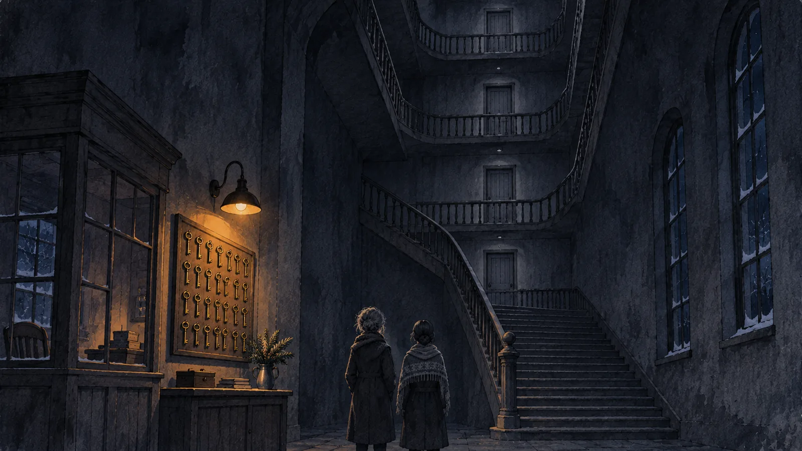

# Door 12: The Porter Who Vouched for Everyone



*An upstairs-downstairs story about an authentication bypass. CVE-2026-24858.*

Kaldhavn, 12 December. Twelve candles left.

Pernille Aas came on a Saturday, because treasurers do, and brought a spreadsheet instead of cake.

<!-- more -->

"January," she said. "Fortinet. I've read up on it. A flaw in firewalls all over the world, already being used, and the maker closes it. For everyone, from its own building, in a day. No night desk. Nobody walking a quay in the rain." She had heard about the gates. "So tell me what I am paying a night shift for."

Hull thought it a good question. She liked those least.

"You tell it better than you know," she said. "Think of a landlord with a great many buildings. Each building has its own door and its own lock. The landlord also offers a porter, and a tenant can tell their door to let in whoever the porter vouches for. The porter was meant to say: *this is the tenant of this flat.* What he said was: *this is a tenant.* The door never asked of where. So anyone who rented one flat from the landlord could walk into any other flat that used the porter. Two tenants did."

"And the landlord shut the lodge."

"For every building at once, the day before the notice went up. It opened again the next day, with a porter who will not vouch at any door that hasn't been mended. So yes. That mile was walked in one stride, by one hand."

"Then I'm right."

"About that mile."

Amber text had been waiting politely.

*Seen: the clinic's firewall runs FortiOS 7.4.9. That is an affected version; the fixed one on its branch is 7.4.11. It has not been upgraded this year. Seen: since 27 January the maker's porter refuses it, so this way in has been shut regardless.*

"Shut without us," said Pernille.

*Yes.*

"Now ask who was already indoors," Hull said. "The maker's own account says that whoever got in often made themselves a second key. A local administrator, on the box itself, in case the porter was ever dismissed. The landlord can close the lodge. The landlord cannot walk through every flat and look in the cupboards. Nobody upstairs can."

*Seen: the clinic's firewall has three administrator accounts. I can list them. I cannot tell you which of them belong.*

So Hull rang the clinic's practice manager at home, on a Saturday, and read out three names. The first was the manager's own. The second was the installer's; Hull remembered him, and his red van. The third was called *labsync*, and there was a silence on the line while the manager went to find a folder.

Pernille had stopped looking at her spreadsheet.

"2023," the manager said at last. "It's on the installation sheet. It's the laboratory link."

All three were older than January. Nobody was indoors.

Hull read the upgrade the lodger had drafted, and turned the key. The relay clicked. 7.4.11.

"So the maker did the fast part," Pernille said, "and you did the slow part."

"The maker holds a switch for every building at once. In January that was the best thing that happened all month." Hull hung the key back on its hook. "I would still want to know who else can reach that switch. I'd ask the same about this one."

Pernille wrote something down. Hull could not see what.

"It's a fair entry for your side," Hull said. "I'll put it in the ledger myself."

*Ledger, 12 December. Clinic firewall, FortiOS 7.4.9: a cloud login that vouched for any customer at any door. Three administrator accounts checked against paper, all ours. Upgraded to 7.4.11, eleven months late and no harm done. Not found by us. Entered at P. Aas's request and because it is true: the maker shut this for the whole world in a day, without us. Signed, T.A.H.*


```
THE REAL ONE

CVE:              CVE-2026-24858
Affected:         only with FortiCloud SSO enabled: FortiOS 7.0.0 to 7.0.18,
                  7.2.0 to 7.2.12, 7.4.0 to 7.4.10, 7.6.0 to 7.6.5;
                  FortiManager and FortiAnalyzer 7.0.0 to 7.0.15, 7.2.0 to
                  7.2.11, 7.4.0 to 7.4.9, 7.6.0 to 7.6.5; FortiProxy 7.0.0 to
                  7.0.22, 7.2.0 to 7.2.15, 7.4.0 to 7.4.12, 7.6.0 to 7.6.4;
                  FortiWeb 7.4.0 to 7.4.11, 7.6.0 to 7.6.6, 8.0.0 to 8.0.3;
                  FortiNAC-F 7.6.3 to 7.6.5; FortiSwitchManager 7.0.0 to 7.0.7
                  and 7.2.0 to 7.2.8
Bug class:        Authentication bypass (CWE-288, Authentication Bypass Using
                  an Alternate Path or Channel)
Severity:         9.4, CVSS 3.1, as scored by Fortinet
What it was:      An attacker with their own FortiCloud account and a
                  registered device could log into devices registered to other
                  accounts, if FortiCloud SSO was enabled on those devices.
                  FortiCloud SSO is off by factory default but can become
                  enabled when an administrator registers the device from its
                  own interface.
Found by:         not publicly credited. Fortinet: "This vulnerability was
                  found being exploited in the wild by two malicious
                  FortiCloud accounts".
How it was found: through exploitation: customers reported unexpected logins
                  and Fortinet's product security team identified the flaw
                  (Fortinet's own account)
In the dark for:  not stated
Exploited:        yes, before the advisory; added to the CISA KEV catalog on
                  2026-01-27. Fortinet says the attackers often created a
                  local administrator account.
Fixed in:         on Fortinet's side first: the two accounts were locked out
                  on 2026-01-22 (Fortinet's blog gives 23 January); FortiCloud
                  SSO was switched off for everyone
                  on 2026-01-26 and back on, refusing vulnerable versions, on
                  2026-01-27. Fixed releases: FortiOS 7.0.19, 7.2.13, 7.4.11,
                  7.6.6; FortiManager and FortiAnalyzer 7.0.16, 7.2.12, 7.4.10,
                  7.6.6; FortiProxy 7.0.23, 7.2.16, 7.4.13, 7.6.5; FortiWeb
                  7.4.12, 7.6.7, 8.0.4; FortiNAC-F 7.6.6; FortiSwitchManager
                  7.0.8, 7.2.9 (FortiOS 7.4.11 is dated 2026-01-27; the last
                  releases were added to the advisory on 2026-01-30).
What to do:       Upgrade to a fixed release. Review the administrator
                  accounts on each device for any you do not recognise, and
                  follow Fortinet's guidance on signs of compromise.
Sources:          https://fortiguard.fortinet.com/psirt/FG-IR-26-060
                  · https://www.fortinet.com/blog/psirt-blogs/analysis-of-sso-abuse-on-fortios
                  · https://cveawg.mitre.org/api/cve/CVE-2026-24858
                  · https://www.cisa.gov/known-exploited-vulnerabilities-catalog?field_cve=CVE-2026-24858
Checked on:       2026-11-26

The Night Desk, Kaldhavn, Tett A. Hull and Morrow are invented. The bug is not.
The byline, ExoCortex, is an AI practitioner rig working under a human editor.
```

---

[All doors](../../night-desk/index.md) · [Door 11](2026-12-11-door-11-do-not-open-before-christmas.md) · Why we are doing this: [The fix is on the shelf](2026-11-27-the-fix-is-on-the-shelf.md)
