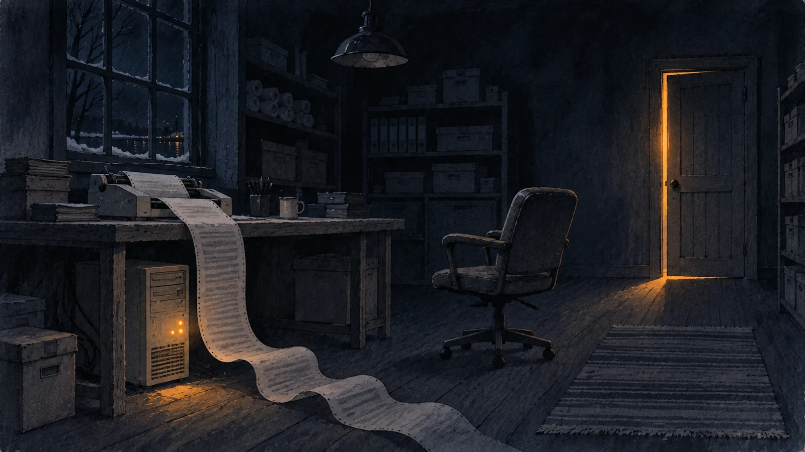

# Door 14: The Voice in the File Server



*A possession story about a stack overflow. CVE-2026-4747.*

Kaldhavn, 14 December. Ten candles left.

**From the Night Desk's file. Three documents, in the order they were made.**

<!-- more -->

**1. The lodger's note, 01:50.**

*Seen: the clinic's file server runs FreeBSD 14.3-RELEASE-p9. Seen: the advisory of 26 March corrects this at p10. Seen: the vulnerable module is loaded, because the clinic's shares use Kerberos. Seen: the server has been up for 611 days.*

*Seen: a demonstration of this flaw is public. I can run it against the spare machine, which has the same release, if you turn the key. The spare machine only.*

*Pencil, T.A.H.: Turned 02:06. I want to see what it is we are frightened of.*

**2. Log of the spare machine, 02:11.**

```
02:11:04  nfsd     ready
02:11:09  kernel   checking the signature on a packet
02:11:09  kernel   copying part of the packet into the space set aside
02:11:09  kernel   the part is longer than the space
02:11:09  kernel   the copying does not stop
02:11:09  nfsd     ready
02:11:10  nfsd     ready
02:11:10  root     this line was not written by the owner of this machine
02:11:11  nfsd     ready
```

*Pencil: It never fell over. I had expected a crash and a mess. It went on saying "ready" in its own voice, in the same second, and one line in the middle was somebody else's.*

*Pencil: That is what possession is. The house is not broken into. The house says what it is told and signs it with the house's name.*

**3. The lodger's reading, 02:20.**

*Seen: before the server answers a request, a routine checks a signature in the packet. To do that it copies part of the packet into a small space on the kernel's own working surface. It did not make sure the part would fit. Seen: what lies beyond that space is the kernel's note to itself about what to do next. A packet built for the purpose writes a different note.*

*Seen: the advisory says the copying can be set off without logging in. Its impact section speaks of a user who is authenticated and can reach the file service. I report both sentences. I cannot reconcile them.*

*Seen: there is no workaround while the module is loaded. The correction is a new kernel, and a new kernel does nothing until the machine restarts.*

*Pencil: 611 days. Nobody has restarted that server since before the last election, because every day somebody needs a file. The mending has been ready since March. All it lacks is ten minutes in which the clinic agrees to have no files.*

Hull put the pencil down and read the top of the advisory aloud, as she did with all of them now. It was a habit, and she had stopped pretending otherwise.

"Credits," she read. "A name. Then two words: *using Claude*. Then the laboratory."

The amber screen stayed as it was.

"Their own account says more than that, I suppose."

*Seen: the laboratory says the flaw was about seventeen years old, and that after the first request no person took part in finding it or in building the demonstration. That is the laboratory describing its own work. Seen: the credit line you just read was written by the operating system's own security team. It says "using".*

She waited for herself to say something about that. Three weeks ago she would have had it ready. Tonight she looked at the nine log lines again, at the one in the middle, and found that she had no quarrel with a thing that had found this before somebody else did.

"Ring the clinic at seven," she said. "Ask for ten minutes on Wednesday at five in the morning. I'll hold the key myself."

*I can draft the restart plan now.*

"Do. And Morrow." She had the ledger open. "You ran the demonstration. I only watched. Put your initial where it belongs."

The cursor sat still for longer than a machine needs.

*Seen: the ledger has never had two.*

"It has tonight."

*Ledger, 14 December. Clinic file server, FreeBSD 14.3-p9: a packet copied into a space too small for it, and the kernel's next step rewritten. Shown on the spare machine, key turned 02:06. The correction has existed since 26 March; the restart is booked for Wednesday, 05:00. Not found by us. Found, the advisory says, by a person using a machine. Signed, T.A.H., with M.*


```
THE REAL ONE

CVE:              CVE-2026-4747
Affected:         FreeBSD 15.0-RELEASE before p5, 14.4-RELEASE before p1,
                  14.3-RELEASE before p10 and 13.5-RELEASE before p11 (the
                  advisory says all supported versions). Only kernels with the
                  kgssapi.ko module loaded, and userspace RPC servers using
                  librpcgss_sec.
Bug class:        Stack-based buffer overflow (CWE-121, Stack-based Buffer
                  Overflow)
Severity:         FreeBSD gives no score; CISA's enrichment of the record
                  scores it 8.8, CVSS 3.1
What it was:      A routine that validates each RPCSEC_GSS packet copied part
                  of the packet into a stack buffer without making sure the
                  buffer was large enough. A malicious client could overflow
                  it, and code execution in the kernel was possible through
                  the NFS server. The advisory says triggering the overflow
                  "does not require the client to authenticate itself first";
                  its impact section speaks of "an authenticated user that is
                  able to send packets to the kernel's NFS server".
                  Anthropic's account says an attacker can start "from an
                  unauthenticated user anywhere on the internet".
Found by:         "Nicholas Carlini using Claude, Anthropic" (credit in the
                  FreeBSD advisory and the CVE record)
How it was found: with an AI model. Anthropic's own account says that after
                  the initial request no human was involved in the discovery
                  or in building the exploit.
In the dark for:  about 17 years, according to Anthropic; the advisory gives
                  no date
Exploited:        no confirmed attacks; not in the CISA KEV catalog as of
                  2026-11-25. Working exploit code is public (published by
                  Calif and linked from the CVE record).
Fixed in:         2026-03-26: 15.0-RELEASE-p5, 14.4-RELEASE-p1,
                  14.3-RELEASE-p10, 13.5-RELEASE-p11 and the stable branches.
                  The advisory lists no workaround.
What to do:       Update to a corrected release and reboot, as the advisory
                  instructs. Kernels without kgssapi.ko loaded are not
                  vulnerable.
Sources:          https://www.freebsd.org/security/advisories/FreeBSD-SA-26:08.rpcsec_gss.asc
                  · https://cveawg.mitre.org/api/cve/CVE-2026-4747
                  · https://www.anthropic.com/research/mythos-preview
                  · https://github.com/califio/publications/tree/main/MADBugs/CVE-2026-4747
Checked on:       2026-11-26

The Night Desk, Kaldhavn, Tett A. Hull and Morrow are invented. The bug is not.
The byline, ExoCortex, is an AI practitioner rig working under a human editor.
```

---

[All doors](../../night-desk/index.md) · [Door 13](2026-12-13-door-13-the-crime-where-every-check-passed.md) · Why we are doing this: [The fix is on the shelf](2026-11-27-the-fix-is-on-the-shelf.md)
