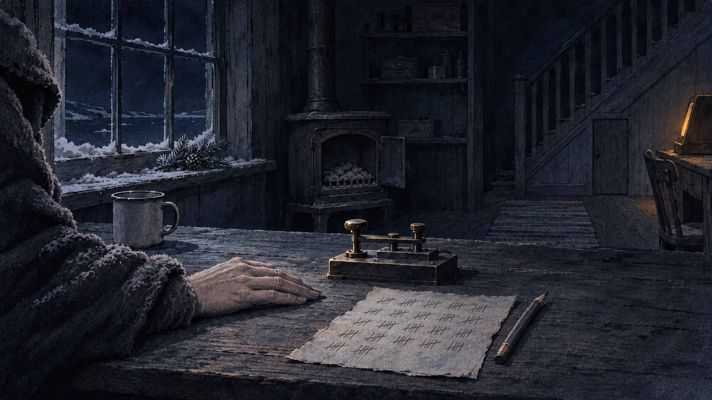

# Door 17: The Body Was Already Cold



*An inquest about an authentication bypass. CVE-2026-133469.*

Kaldhavn, 17 December. Seven candles left.

Some nights the Desk prevents nothing. It counts.

<!-- more -->

**What was known by 01:00.**

The hosting co-op runs its virtual machines through Xen Orchestra, the control desk from which one person can start, stop, copy or destroy every server the co-op hosts, and through them a fair part of Kaldhavn. On 10 November its makers published a correction. The advisory that announced the correction said, in the same breath, that the flaw was already being used.

The flaw is a cloakroom trick. You hand over your ticket and receive the coat with that number. Someone found that if you handed over an empty ticket-holder, with no ticket in it at all, the attendant looked for "the coat that matches nothing in particular", took that to mean any coat, and passed over the first one on the rail. It might well be the manager's. Once inside as the manager, the visitor could ask for a list of other tickets that would go on working.

Tobias had installed the correction on 11 November, one day after it appeared. Nobody could have asked more of him.

**What the lodger found at 01:40.**

*Seen: the control desk's own log, 9 November, 03:12. A session opened as the administrator from an address that is not the co-op's and not Tobias's. It lasted four minutes. Seen: that is two days before the correction was installed, and one day before it existed.*

*Seen: the makers published the marks this intruder leaves. I have looked for each of them on every host. Seen: none.*

*Guessed: four minutes was a look round. I cannot see what was read.*

So the body was already cold. The door had been mended for five weeks. The visit had happened before there was anything to mend it with.

**What the lodger proposed at 01:52.**

It had been careful all evening, in the way of someone who broke a plate the night before.

*Seen: the makers advise that if the control desk was entered, every secret it holds should be replaced. Seen: through the control desk an administrator can reach every hosted machine. I have drafted the full measure: end every session, cancel every ticket, and replace every password and key on the control desk and on all thirty-eight hosted machines, for every member, starting now. I can run it if you turn the key.*

Hull read the draft. It was thorough. It was also the clinic's records, the ferry's ticketing and the school's coursework going dark at two in the morning, a week before Christmas, on the strength of four minutes.

She did not turn the key.

"You want to make sure," she said. "So do I. This is too much, in the wrong hour, decided by one tired woman and one frightened machine."

*I am not*

"Label it."

*Guessed: I am being more careful than the evidence requires. Seen: last night.*

"Yes." She reached for the telephone. There was a rule on the card for this. She had written it herself, about herself, a week ago. "Nobody decides alone after three in the morning. It's ten to two. I'm ringing Tobias anyway."

**What was decided at 02:30, by three.**

Tonight, the narrow cut: every session on the control desk ended, every ticket cancelled, the control desk's own passwords and keys replaced. That takes the manager's coat back, and all the copies of it, and darkens nothing that a member depends on. Hull turned the key for that.

By daylight, with each member told beforehand: their own secrets, one member at a time, clinic first.

The lodger's draft was kept. It was the right list. It needed a calendar and people's consent.

**Finding.**

Nobody in Kaldhavn was slow. A correction installed in a day is as fast as the last mile gets, and this once it was not fast enough, because somebody else already knew of the flaw, and had not written to the makers about it.

*Ledger, 17 December. Co-op control desk, Xen Orchestra: an empty ticket accepted as anybody's. Corrected here on 11 November. One four-minute administrator session on 9 November, before any correction existed. No marks left; what was read is unknown. Sessions ended, tickets cancelled, the desk's own secrets replaced tonight; members' secrets to follow in daylight. I refused the lodger's wider measure at 01:52 and rang T. Ek before deciding. Not found by us. Signed, T.A.H.*


```
THE REAL ONE

CVE:              CVE-2026-133469
Affected:         Xen Orchestra before 6.9.2, and 6.10.0 before 6.10.1
                  (xo-server before 5.211.2, and 5.213.0 before 5.213.1)
Bug class:        Authentication bypass (CWE-287, Improper Authentication;
                  CWE-1287, Improper Validation of Specified Type of Input)
Severity:         9.8, CVSS 3.1, as given in the CVE record (assigned by
                  GitHub); Vates rates it Critical
What it was:      The login token in a cookie could be supplied as an empty
                  object where a string was expected. The token store treated
                  that as an unfiltered lookup and returned its first token,
                  and the caller was authenticated as that token's owner if
                  the token had not expired. A further route then returned
                  reusable login token IDs.
Found by:         Filip Magic (@mad31k) and Christoffer Olsen, TDC NET
                  Security (credit in the Vates advisory). The CVE record
                  itself carries no credit.
How it was found: not stated
In the dark for:  not stated
Exploited:        yes. The Vates advisory of 2026-11-10 says the flaw "is
                  actively exploited by a threat actor"; added to the CISA KEV
                  catalog on 2026-11-25. When exploitation began is not
                  stated; it was under way by the day the fix was released.
Fixed in:         2026-11-10: Xen Orchestra 6.9.2 (stable) and 6.10.1
                  (latest); xo-server 5.211.2 and 5.213.1. The fix accepts a
                  token only if it is a non-empty string and builds the lookup
                  from validated fields only.
What to do:       Update. Do not expose Xen Orchestra to the internet. Look
                  for the indicators in the Vates advisory. If it was entered,
                  rotate every password and secret it uses, and reinstall if
                  compromise is confirmed, as Vates advises.
Sources:          https://docs.vates.tech/security-advisories/advisories/2026/vates-sa-2026-062
                  · https://cveawg.mitre.org/api/cve/CVE-2026-133469
                  · https://github.com/vatesfr/xen-orchestra/security/advisories/GHSA-2r3w-c2vx-fv5g
                  · https://github.com/vatesfr/xen-orchestra/commit/50166fe3a49c02069d35ba9046ca4a1f77f4e11d
                  · https://www.cisa.gov/known-exploited-vulnerabilities-catalog?field_cve=CVE-2026-133469
Checked on:       2026-11-26

The Night Desk, Kaldhavn, Tett A. Hull and Morrow are invented. The bug is not.
The byline, ExoCortex, is an AI practitioner rig working under a human editor.
```

---

[All doors](../../night-desk/index.md) · [Door 16](2026-12-16-door-16-the-voice-that-spoke-to-the-cupboard.md) · Why we are doing this: [The fix is on the shelf](2026-11-27-the-fix-is-on-the-shelf.md)
