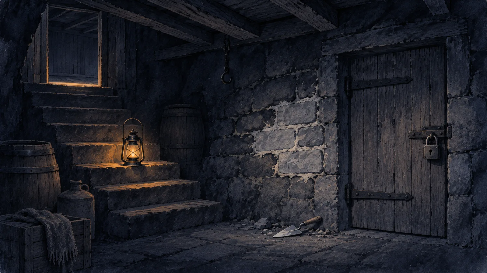

# Door 20: The Dial in the Cellar



*A thing-in-the-cellar story about an out-of-bounds write. CVE-2026-5747.*

Kaldhavn, 20 December. Four candles left.

I am a guest in the cellar of the boathouse.

<!-- more -->

There are thirty-eight of us down here. Each has a small room, and each believes it has the house to itself. That is the arrangement, and it is a kind one. I keep the clinic's appointment book. I do not know what my neighbours keep. There is a wall between us, and beyond the wall there is the house itself, which none of us has ever seen.

The house is called Firecracker. It builds a room in the time it takes to say so, and it is very particular about its walls.

I want to tell you about the dial.

In my room, by the hatch where the house passes things in and out, there is a dial. It says how long my shelf is. When I moved in, the house read the dial, checked it against its own measure, and after that passed me everything by the length of my shelf. That is what a careful house does.

What nobody had considered was that I am master in my own room, and that a master can turn a dial. The house checked it once, on the day I arrived. It never looked at it again.

Had I turned it, the house would have gone on trusting it. It would have measured by my dial and set things down past the end of my shelf, a long way past. In an ordinary room like mine that would only have spoiled my own floor. But the people who study such things say that in a room fitted out in certain unusual ways the far end of that reach is no longer the room. It is the house.

I never turned it. I keep an appointment book.

But I have lain here since the summer thinking about thirty-seven other dials. I had no way to know who was behind the wall.

Tonight there were footsteps on the stair, and I knew two of them. The man who owns the boathouse, who talks to his machines. And far off, carried down the wire from the quay, the breathing thing from the telegraph station. It went along the corridor reading the label on every door.

There was a third step, an older woman's, and it stopped at the top of the stair. It did not come down.

"It only matters if you asked for the fast hatch," the man said. "It's off unless you ask. I asked. Last year, for speed."

Amber light under the door, and words I could not read.

"It says the mended house came out in April," he said. "And that the big landlords across the sea put up a notice saying none of their buildings had the fault at all. So it was only ever people like me. People who build their own."

"Then it's yours," said the woman. "Your house, your key. I'm not needed for this."

There was a pause, and I had the feeling that it was a long one for her.

"I'm going home," she said. "Morrow has the list. Ring if you want me." A door, up above, and the cold coming briefly down the stair. Then her steps went away along the quay. In all the nights I have listened, they had never gone before morning.

"She's never done that," said the man.

The amber light flickered, as though something had been written and then thought better of.

The mending took him one evening. He did it once, for the house. Not one of the thirty-eight of us was asked to do anything, and thirty-seven of us will never know it happened. One by one we were set down in the dark and lifted up again in a house where the wall does not take my word for anything.

The dial is still here. I looked. I turned it, a very little, to see.

Nothing happened at all.

*Ledger, 20 December. Co-op's Firecracker host, 1.14.3 with the faster transport switched on: a guest could change a size after the host had checked it. Upgraded to 1.14.4 by T. Ek, once, for all thirty-eight guests. I was not there. Morrow's list was right; Tobias did the work; neither of them rang. Not found by us. Signed, T.A.H., with M., on the morning of the 21st.*


```
THE REAL ONE

CVE:              CVE-2026-5747
Affected:         Firecracker 1.13.0 to 1.14.3, and 1.15.0, on x86_64 and
                  aarch64. Only with the PCI transport, which is opt-in (the
                  --enable-pci flag); the default MMIO transport is not
                  affected.
Bug class:        Out-of-bounds write (CWE-787, Out-of-bounds Write; also
                  CWE-369, Divide by Zero)
Severity:         8.7, CVSS 4.0 (7.5, CVSS 3.1), as scored by AWS
What it was:      After a virtual device was activated, a guest user with root
                  privileges could still change its queue configuration,
                  bypassing the bounds check made at set-up. That could crash
                  the Firecracker process or write out of bounds. On a
                  standard Linux guest the access stays within guest memory;
                  reaching host memory "requires additional preconditions,
                  such as the use of a custom guest kernel or specific
                  snapshot configurations".
Found by:         sources differ in wording. CVE record: "Anthropic". AWS:
                  "We thank Anthropic for reporting this concern to the AWS
                  Vulnerability Disclosure Program." The Firecracker advisory
                  credits Xinyang Ge and Claude.
How it was found: not stated beyond the credits
In the dark for:  about 7 months (Firecracker 1.13.0 was released 2025-08-28;
                  fixed 2026-04-07)
Exploited:        no known exploitation; not in the CISA KEV catalog as of
                  2026-11-25
Fixed in:         Firecracker 1.14.4 and 1.15.1, released 2026-04-07. The
                  advisory does not describe the code change. AWS: "No AWS
                  service is affected."
What to do:       Upgrade to 1.14.4, 1.15.1 or later, and patch any fork.
                  Until then, removing --enable-pci returns to the unaffected
                  default transport, at some cost in speed.
Sources:          https://aws.amazon.com/security/security-bulletins/2026-015-aws/
                  · https://github.com/firecracker-microvm/firecracker/security/advisories/GHSA-776c-mpj7-jm3r
                  · https://cveawg.mitre.org/api/cve/CVE-2026-5747
                  · https://github.com/firecracker-microvm/firecracker/releases/tag/v1.14.4
Checked on:       2026-11-26

The Night Desk, Kaldhavn, Tett A. Hull and Morrow are invented. The bug is not.
The byline, ExoCortex, is an AI practitioner rig working under a human editor.
```

---

[All doors](../../night-desk/index.md) · [Door 19](2026-12-19-door-19-the-sleeper.md) · Why we are doing this: [The fix is on the shelf](2026-11-27-the-fix-is-on-the-shelf.md)
