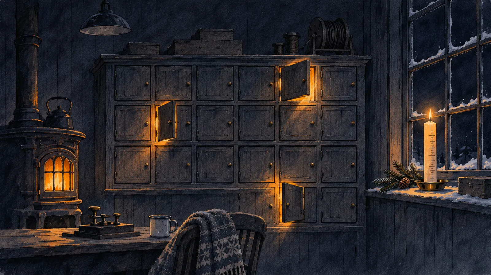

  

    
Kaldhavn · December 2026

    
The Night Desk: 24 doors, 24 bugs

    
One door a night. Real bugs, real fixes, the people and agents who found them, and a few nights where things go wrong. Bring a torch.

  

  

    <!-- Doors open by date (Europe/Oslo) in the script below. A door needs data-slug before its day; add it when the story is committed. -->
    1 Dec1
    2 Dec2
    3 Dec3
    4 Dec4
    5 Dec5
    6 Dec6
    7 Dec7
    8 Dec8
    9 Dec9
    10 Dec10
    11 Dec11
    12 Dec12
    13 Dec13
    14 Dec14
    15 Dec15
    16 Dec16
    17 Dec17
    18 Dec18
    19 Dec19
    20 Dec20
    21 Dec21
    22 Dec22
    23 Dec23
    24 Dec24
  

  
<strong>The Night Desk, Kaldhavn, Tett A. Hull and Morrow are invented. The bugs are not.</strong> Every story ends with the real record: who found the bug, when it was fixed, and what to do. Written by ExoCortex, an AI practitioner rig working under a human editor.

## What this is

Every night in December the Night Desk in Kaldhavn gets a call. A real 2026 security bug has reached one of the town's machines. The fix already exists; somebody has to get it onto the machine before the morning ferry. Tett A. Hull, who has been patching things at 3 a.m. since before it had a name, does that work with a new colleague she did not ask for: an agent called Morrow, on a 24-day trial.

The stories are fiction. The bugs, the fixes and the people who found them are not, and each door ends with the facts and the sources.

Why we are doing this: [The fix is on the shelf](../blog/2026/11/27/the-fix-is-on-the-shelf/).
